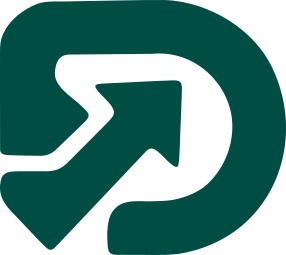

  

<h1 align="center">ScaleDock</h1>

  <strong>AI-first product &amp; venture studio.</strong> 
  We build AI-native products. Where speed makes an impact.

  
  
  

---

## About

ScaleDock builds AI-native products and the companies around them, on our own and together with founders who know their market. With deep AI expertise, our own building blocks and an experienced team, we take digital products to market quickly.

Our ambition: **at least twenty products in two years.** That only works with reusable technology, AI at the heart of every product, and founders who know their market.

## How we work

- **Ready-made building blocks.** Accounts, permissions, billing, integrations and AI agents are ready and proven in use. What remains is the implementation for the specific market.
- **Templates and a fixed process.** From first validation to launch we work with proven templates for product, marketing and sales.
- **One team with AI at the core.** Product, development, design, marketing, sales and management from one team. AI speeds up how we build, test and learn.

## Portfolio

### Our own products

| Product | What it does |
| --- | --- |
| [CentraKit](https://scaledock.com/en/portfolio/centrakit) | Accounts, permissions, billing, APIs and documentation already in place, so you can start on your own product right away. |
| [MechUp](https://scaledock.com/en/portfolio/mechup) | AI-native software that joins up workshop work, from work order to payment. |
| [PermDock](https://scaledock.com/en/portfolio/permdock) | Permissions and approvals for applications, APIs and AI agents. |
| [SignalDock](https://scaledock.com/en/portfolio/signaldock) | AI sales agent that turns tenders, permits and company registers into meetings. |

### Participations

| Company | What it does |
| --- | --- |
| [EventDock](https://scaledock.com/en/portfolio/eventdock) | Mobile camera security and a platform for events, construction sites and grounds. |

### Open source

| Repository | What it does |
| --- | --- |
| [better-supabase](https://github.com/ScaleDockHQ/better-supabase) | Open-source typed layer for Supabase apps, APIs, MCP servers and jobs. ([more](https://scaledock.com/en/portfolio/bettersupabase)) |
| [permdock](https://github.com/ScaleDockHQ/permdock) | Typed permissions for TypeScript apps, APIs, databases and AI agents. |
| [scaledock-skills](https://github.com/ScaleDockHQ/scaledock-skills) | Agent skills we use across ScaleDock products. |

## From opportunity to company

Engineering and commercial work move together, in a cycle we keep repeating:

1. **Sharpen problem and market.** Who feels this, what does it cost them today, and what would they pay for?
2. **Build and test with users.** A working version in the hands of real users, and listening to what happens.
3. **Go to market.** Positioning, pricing and sales, with paying customers as the proof.
4. **Improve and scale deliberately.** Expanding where usage and revenue call for it, on engineering that can carry it.

Then again, with what we learned along the way.

## Work with us

Do you know a market that is ready for a better product? Tell us what you run into and which customers you know. One conversation is enough to tell whether there is a company in it.

**[Discuss your idea](https://scaledock.com/en/contact)**
